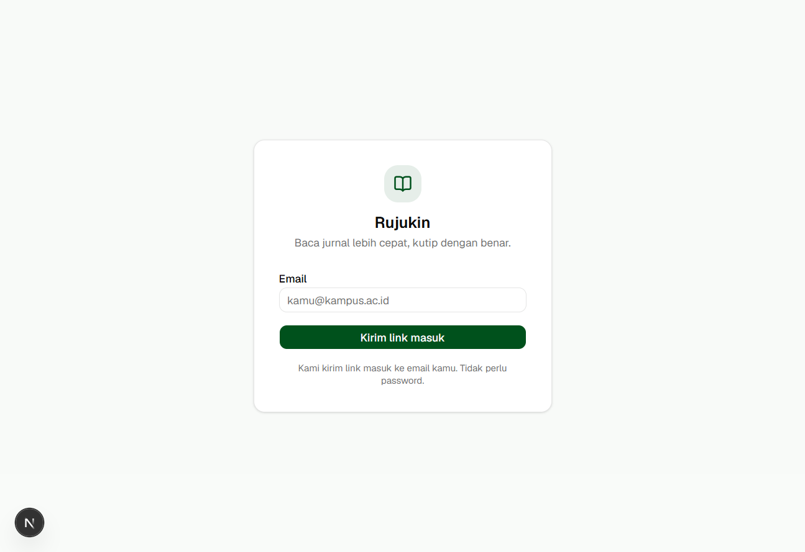
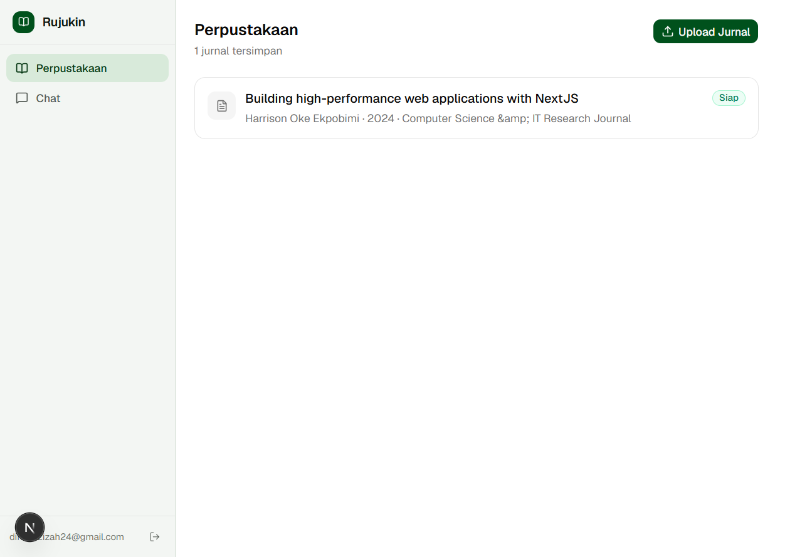
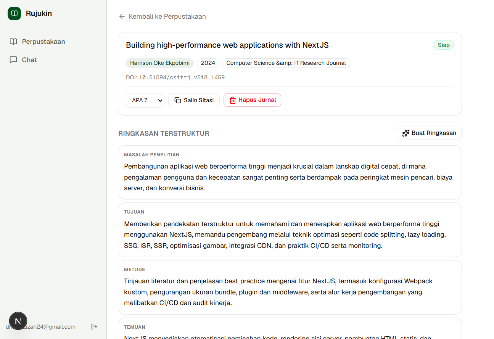
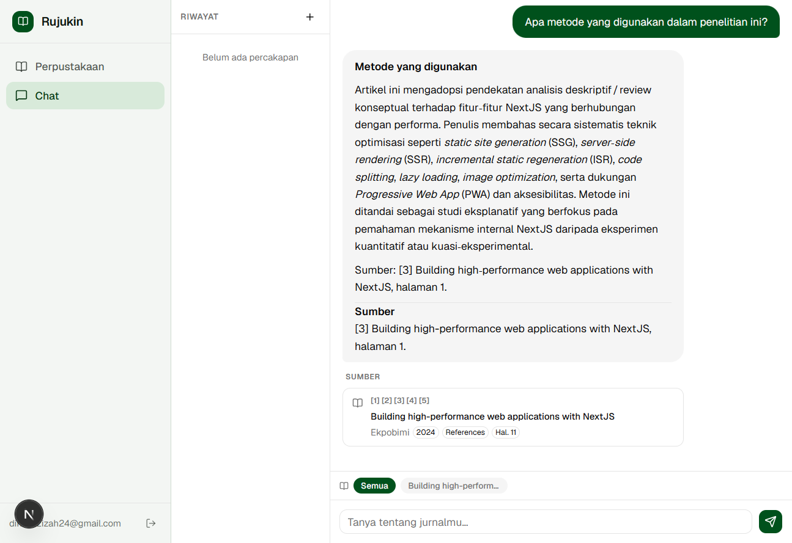

# Rujukin

AI research assistant untuk mahasiswa Indonesia. Upload PDF jurnal, tanya dalam bahasa apapun, dan dapatkan jawaban yang selalu disertai sumber dari perpustakaanmu — tidak ada referensi yang dikarang-karang.

## Screenshots

| Login | Perpustakaan |
|---|---|
|  |  |

| Detail Jurnal | Chat dengan Sitasi |
|---|---|
|  |  |

## Fitur

- **Upload & proses jurnal** — upload PDF; sistem otomatis mengekstrak teks, membuat chunk, dan menghasilkan embedding
- **Ringkasan terstruktur** — setiap jurnal dianalisis menjadi: masalah, tujuan, metode, data, temuan, keterbatasan, dan saran penelitian
- **Chat berbasis RAG** — tanya apa saja; jawaban selalu dikutip dari halaman dan bagian spesifik jurnalmu
- **Filter jurnal di chat** — pilih satu atau beberapa jurnal sebelum bertanya supaya konteks lebih fokus
- **Sitasi otomatis** — salin sitasi APA 7, IEEE, atau Harvard langsung dari halaman detail jurnal
- **Nomor sumber di jawaban** — setiap klaim ditandai `[1]`, `[2]`, dst. dengan kartu sumber di bawah jawaban
- **Riwayat percakapan** — setiap chat tersimpan otomatis dan bisa dilanjutkan kapan saja
- **Hapus jurnal & percakapan** — dengan konfirmasi sebelum penghapusan permanen
- **UI error rate limit** — pesan yang jelas saat kuota Groq, Gemini, atau Upstash habis

## Stack

| Layer | Teknologi |
|---|---|
| Framework | Next.js 16 (App Router) |
| Database & Auth | Supabase (PostgreSQL + pgvector + Storage) |
| Text generation | Groq (`openai/gpt-oss-20b`) |
| Embeddings | Google Gemini (`gemini-embedding-001`, 768 dims) |
| AI SDK | Vercel AI SDK v7 |
| UI | shadcn/ui + Tailwind v4 |
| Rate limiting | Upstash Redis |

## Setup

### 1. Prasyarat

- Node.js 20+
- Akun [Supabase](https://supabase.com)
- API key [Groq](https://console.groq.com)
- API key [Google AI Studio](https://aistudio.google.com/apikey)
- Database [Upstash Redis](https://console.upstash.com) (gratis)

### 2. Clone & install

```bash
git clone https://github.com/your-username/rujukin.git
cd rujukin
npm install
```

### 3. Environment variables

```bash
cp .env.local.example .env.local
```

Isi semua nilai di `.env.local`:

```env
NEXT_PUBLIC_SUPABASE_URL=
NEXT_PUBLIC_SUPABASE_PUBLISHABLE_KEY=
SUPABASE_SERVICE_ROLE_KEY=

GROQ_API_KEY=
GROQ_MODEL=openai/gpt-oss-20b

GOOGLE_GENERATIVE_AI_API_KEY=

UPSTASH_REDIS_REST_URL=
UPSTASH_REDIS_REST_TOKEN=
```

### 4. Database

Buka Supabase SQL Editor dan jalankan migrasi:

```
supabase/migrations/0001_initial.sql
```

File ini membuat semua tabel, fungsi `match_chunks()` untuk pencarian vektor, RLS policies, dan storage bucket.

### 5. Jalankan

```bash
npm run dev
```

Buka [http://localhost:3000](http://localhost:3000).

## Cara Pakai

1. **Login** — masukkan email, klik magic link di inbox
2. **Upload jurnal** — klik *Upload Jurnal*, pilih PDF; status otomatis berubah ke *Siap* setelah diproses
3. **Baca ringkasan** — klik jurnal untuk melihat ringkasan terstruktur dan salin sitasi
4. **Tanya** — buka Chat, ketik pertanyaan; setiap jawaban disertai sumber, bagian, dan nomor halaman
5. **Filter jurnal** — pilih chip jurnal di atas kolom teks untuk memfokuskan pencarian ke jurnal tertentu
6. **Lanjutkan chat** — riwayat percakapan tersimpan otomatis di sidebar kiri

## Deployment

Deploy ke Vercel dalam satu langkah:

```bash
npx vercel
```

Pastikan semua environment variable dari `.env.local.example` sudah diisi di dashboard Vercel sebelum deploy.

## Struktur Proyek

```
src/
  app/
    (auth)/login/          # Halaman login magic link
    (app)/
      library/             # Daftar jurnal + polling status
      paper/[id]/          # Detail jurnal + ringkasan + sitasi
      chat/                # Antarmuka chat RAG
    api/
      chat/                # Streaming RAG endpoint (dengan filter paper)
      ingest/              # Pipeline proses PDF
      conversation/        # Simpan & muat riwayat chat
      paper/[id]/          # Hapus jurnal & regenerasi ringkasan
  components/
    paper-list.tsx         # Client component dengan status polling
    paper-filter.tsx       # Chip filter jurnal di chat
    chat-ui.tsx            # Chat UI dengan sidebar riwayat & filter
    citation-cards.tsx     # Kartu sumber kutipan dengan nomor [n]
    upload-button.tsx      # Upload + progress
    delete-paper-button.tsx          # Hapus jurnal dengan konfirmasi
    regenerate-summary-button.tsx    # Buat ulang ringkasan jurnal
  lib/
    embed.ts               # Google Gemini embeddings
    chunk.ts               # Chunking teks PDF
    pdf.ts                 # Ekstraksi teks dari PDF
    retrieve.ts            # Pencarian vektor via pgvector (support filter paper)
    summarize.ts           # Ringkasan terstruktur via Groq
    cite.ts                # Format APA 7 / IEEE / Harvard
    prompts.ts             # System prompt & RAG context builder
    rate-limit.ts          # Rate limiting via Upstash
```
